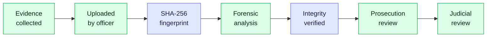
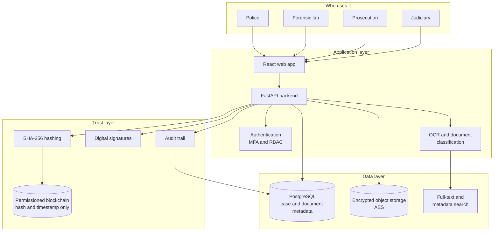
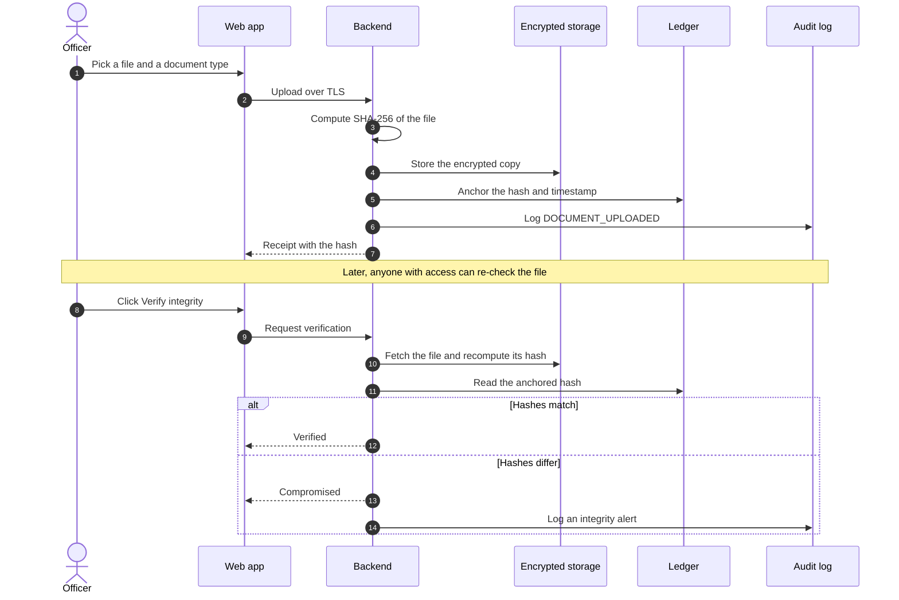
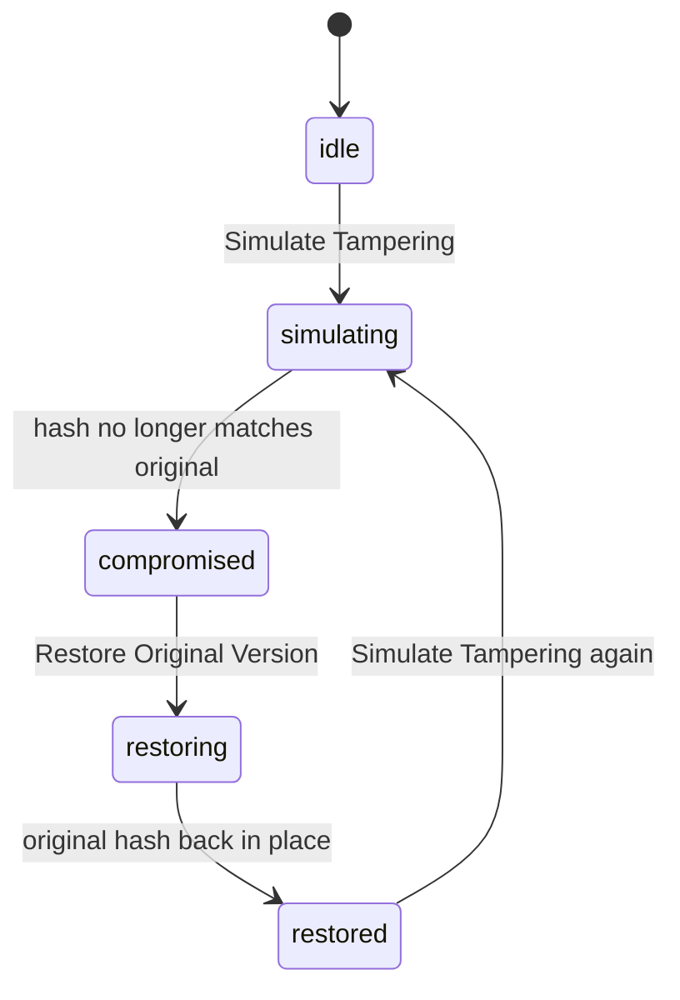

<div align="center">

# SecureCase

**A tamper-evident home for FIRs, evidence records and court documents.**

Team Visionaries · Smart India Hackathon 2026 · Problem Statement 26190


[The problem](#the-problem) · [Our idea](#our-idea) · [Architecture](#architecture) · [What works today](#what-works-today) · [Run it](#running-it-locally) · [Roadmap](#roadmap)

</div>

---

## The problem

Walk into a police station or a district court and you'll still find case files in steel cupboards. An FIR here, a witness statement there, a forensic report that lives on someone's pen drive. When another office needs the same evidence, somebody carries it over or scans it and emails it. Nobody can really say who touched it on the way.

That setup breaks in a few predictable ways:

- **Searching is slow.** Finding one document means knowing which cupboard, which system, or which officer to ask.
- **Records are scattered.** Half the case is on paper, a quarter is on a shared drive, the rest is in someone's inbox.
- **Transfers are risky.** Handing evidence between police, forensic labs, prosecutors and courts means physical movement or manual sharing.
- **Integrity is hard to prove.** If a PDF changes by a single byte, how does anyone show that it did, or that it didn't?
- **Access is too loose.** Sensitive evidence shouldn't be visible to everyone who happens to have a login.

## Our idea

SecureCase is a single platform where authorised police, forensic, prosecution and court users can store, share and verify legal documents and digital evidence, with every action recorded.

The core trick is simple. When a document goes in, we compute its **SHA-256 fingerprint**. Anyone can recompute that fingerprint later, and if it doesn't match the original, the file has been changed. Around that sits role-based access, a full audit trail, version history and a chain-of-custody view. In the full design the fingerprint and a timestamp are also anchored on a **permissioned blockchain**, so even an administrator can't quietly rewrite history. The document itself never goes on-chain.

| | |
|---|---|
| **Problem Statement ID** | 26190 |
| **Title** | Secure Digital Document Management System for Legal and Investigation Documents |
| **Theme** | Blockchain & Cybersecurity |
| **Category** | Software |
| **Team** | Team Visionaries |

---

## How a document travels



This is the same seven-stage chain you'll see on the **Evidence Chain** page in the app. Blue steps are done by the system, green ones by a person. A note we put in the UI and want to repeat here: it's a custody *visualisation*, not a legally certified chain of custody.

---

## Architecture

This is the system we proposed in our SIH submission. The [next section](#what-works-today) says exactly which parts exist in this repo.



Storage, metadata, search and the ledger are kept as separate pieces on purpose. It means each one can scale (or be swapped) without touching the others, and a department or region can run its own deployment.

### Stack

| Layer | Choice | In this repo? |
|---|---|---|
| Frontend | React 19, Vite, Tailwind CSS 4, React Router 7, Framer Motion, Lucide icons | Yes |
| Hashing | SHA-256 through the browser's Web Crypto API | Yes, and it's real |
| Local data | `localStorage` for metadata, IndexedDB for file contents | Yes, standing in for a backend |
| Access control | Five-role permission matrix | Yes, client-side only |
| Audit trail | Timestamped event log with severity levels | Yes, client-side only |
| Backend API | Python, FastAPI | Planned |
| Database | PostgreSQL | Planned |
| File storage | Encrypted object storage (AES) | Planned |
| Blockchain | Permissioned ledger anchoring hash and timestamp | Planned (the custody view is simulated) |
| OCR and AI | Text extraction and classification of scanned documents | Planned |
| MFA and digital signatures | | Planned |

---

## What works today

The code in this repository is a **frontend prototype**. There's no server. Everything runs in your browser and persists in `localStorage` and IndexedDB, seeded with fictional cases so there's something to click through straight away.

What you can actually do in it:

- **Log in as one of four roles**, each with its own permissions and a role badge in the sidebar.
- **Command Center** dashboard with an overview of cases and activity.
- **Cases and case workspaces.** Each case opens into six tabs: Overview, Documents, Evidence, Access, Timeline and Integrity.
- **Upload a real file.** The app reads the bytes, generates a genuine SHA-256 hash, stores the file in IndexedDB, saves the metadata and writes an audit entry.
- **Version history** per document, each version with its own hash.
- **Tamper detection demo.** Hit *Simulate Tampering* on a document and its hash stops matching the original, the status flips to compromised and an alert is logged. *Restore Original Version* puts it back.
- **Evidence Chain** page showing the custody stages for evidence records and forensic reports.
- **Search** across cases and documents by case ID, FIR number, officer, file name, type, owner or description.
- **Audit Trail** of everything above: logins, uploads, downloads, tamper events and denied actions.
- **Access Control** page that lays out what each role can do, plus a panel where you can try an action as your current role. Denied attempts land in the audit trail as unauthorized-access events.
- **Security Center** summarising integrity checks, failures and audit volume.

### The upload flow, as designed

The prototype does the hashing, metadata and audit steps for real. Encrypted storage and the ledger step are the parts that need the backend.



### The tamper demo



To be upfront about it: the demo doesn't modify a file. It derives a different hash from the original one and swaps it in, which is exactly what a real modification would look like to the verifier. The *check* (current hash versus original hash) is the real mechanism. The *tampering* is staged so you can watch it fire.

---

## Roles and permissions

Five roles, one permission matrix. The UI hides or disables whatever your role can't do.

| Permission | Admin | Police | Forensic | Prosecutor | Judiciary |
|---|:---:|:---:|:---:|:---:|:---:|
| Upload documents | ✅ | ✅ | ✅ | ❌ | ❌ |
| Download documents | ✅ | ✅ | ✅ | ✅ | ✅ |
| Verify integrity | ✅ | ✅ | ✅ | ❌ | ❌ |
| Create cases | ✅ | ✅ | ❌ | ❌ | ❌ |
| View all cases | ✅ | ✅ | ❌ | ❌ | ❌ |
| Manage access | ✅ | ❌ | ❌ | ❌ | ❌ |
| Delete documents | ✅ | ❌ | ❌ | ❌ | ❌ |
| **Access level** | Full admin | Full access | Evidence access | Read access | Read only |

### Demo accounts

These only exist in the seeded browser data. The login page also has one-click buttons for each.

| Role | Email | Password |
|---|---|---|
| Administrator | `admin@securecase.demo` | `admin123` |
| Police officer | `police@securecase.demo` | `police123` |
| Prosecutor | `prosecutor@securecase.demo` | `prosecutor123` |
| Judiciary | `judge@securecase.demo` | `judge123` |

The forensic role is defined in the permission matrix but doesn't have a seeded login yet.

Worth a look: **CASE-2026-027** is seeded with an integrity alert, so you can see what a compromised case looks like without triggering one yourself.

---

## Running it locally

You'll need a recent Node.js (20.19 or newer, or 22+) and npm.

```bash
git clone https://github.com/Guruvesh03/Visionaries.git
cd Visionaries
npm install
npm run dev
```

Vite will print a local address, usually `http://localhost:5173`. Log in with one of the demo accounts above.

```bash
npm run build     # production build into dist/
npm run preview   # serve the production build locally
```

**Resetting the demo.** All data lives in your browser. To start fresh, clear the site's storage in DevTools (Application tab): the `sc_*` keys in localStorage and the `securecase_files` IndexedDB database. The seed data is recreated on the next load.

## Project structure

```
Visionaries/
├── index.html
├── vite.config.js
├── package.json
├── public/
└── src/
    ├── main.jsx                  # entry point
    ├── App.jsx                   # routes and the protected-route wrapper
    ├── index.css                 # global styles
    ├── context/
    │   ├── AuthContext.jsx       # login, session, can() permission checks
    │   └── AppContext.jsx        # cases, documents, audit logs for the UI
    ├── crypto/
    │   └── hash.js               # SHA-256 helpers (Web Crypto API)
    ├── store/
    │   ├── seedData.js           # demo users, cases, documents, PERMISSIONS
    │   ├── localStorage.js       # metadata and audit-log persistence
    │   └── indexedDB.js          # uploaded file contents
    ├── components/layout/
    │   ├── AppLayout.jsx
    │   └── Sidebar.jsx
    └── pages/
        ├── LoginPage.jsx
        ├── DashboardPage.jsx
        ├── CasesPage.jsx
        ├── CaseWorkspacePage.jsx # tabs, upload, versions, tamper demo
        ├── DocumentVaultPage.jsx
        ├── EvidenceChainPage.jsx
        ├── SearchPage.jsx
        ├── AuditTrailPage.jsx
        ├── AccessControlPage.jsx
        └── SecurityCenterPage.jsx
```

---

## Security thinking

These are the risks we identified while designing it, and what the full system does about each.

| Risk | How we'd handle it |
|---|---|
| Data breach | Encryption at rest, least-privilege access, MFA, key rotation |
| Blockchain privacy | Permissioned network, and no document content ever goes on-chain |
| OCR mistakes | Human check on critical fields, and the original scan is always kept |
| Insider misuse | Immutable audit events, anomaly alerts, session controls |
| Legacy systems | REST APIs, phased migration, metadata mapping |

The controls we're building toward: encryption plus MFA plus RBAC, tamper-evident verification of evidence, an immutable audit trail, and backup with disaster recovery.

## Who benefits

- **Investigators** find documents quickly instead of hunting through cupboards and inboxes.
- **Courts and prosecutors** get records they can verify, which speeds up the legal process.
- **Departments** share documents securely instead of moving paper around.
- **Everyone** gets accountability, because every upload, view, edit, download and share leaves a trace.
- **Budgets** feel it too: less paper, less physical storage, less manual handling.
- **Rollout** can start with one police station and grow across departments, since storage, database and application scale independently. Documents, images, videos and forensic files are all in scope.

---

## Known limitations

We'd rather say these here than have you find them.

- **No backend.** Authentication, permissions and the audit log all run in the browser, so they can be bypassed by anyone with DevTools. They demonstrate the design; they don't enforce it.
- **Demo passwords are stored in plain text** in the seed data. That's fine for fictional accounts and unacceptable anywhere else.
- **`localStorage` and IndexedDB are not encrypted storage.** Treat anything you upload to the prototype as readable by the browser profile.
- **Blockchain, AES encryption, OCR, MFA and digital signatures are not implemented yet.** They're part of the proposed system, not this codebase.
- **The tamper demo is staged**, as explained above.
- **Not a certified chain of custody.** The custody view is illustrative.
- **Fictional data.** Every name, FIR number and case in the seed data is made up.

## Roadmap

- [x] Role-based UI with a five-level permission matrix
- [x] SHA-256 hashing on upload (Web Crypto)
- [x] Audit trail, version history and tamper-detection demo
- [x] Chain-of-custody visualisation and cross-case search
- [ ] FastAPI backend with PostgreSQL
- [ ] Server-side authentication with MFA and session management
- [ ] AES-encrypted object storage with key rotation
- [ ] Permissioned blockchain anchoring (hash and timestamp only)
- [ ] Digital signatures on documents
- [ ] OCR and automatic classification of scanned documents
- [ ] Full-text and metadata search over extracted content
- [ ] Anomaly alerts for insider misuse
- [ ] Backup, disaster recovery and REST integration with legacy systems

---

## References

The standards and guidance we leaned on while designing the system:

- [NIST SP 800-63-4, Digital Identity Guidelines](https://www.nist.gov/publications/nist-sp-800-63-4-digital-identity-guidelines): authentication, identity verification, MFA
- [NISTIR 8202, Blockchain Technology Overview](https://www.nist.gov/publications/blockchain-technology-overview): blockchain, hashing, tamper-evident records
- [OWASP Cryptographic Storage Cheat Sheet](https://cheatsheetseries.owasp.org/cheatsheets/Cryptographic_Storage_Cheat_Sheet.html): encrypting sensitive data
- [OWASP Authentication Cheat Sheet](https://cheatsheetseries.owasp.org/cheatsheets/Authentication_Cheat_Sheet.html): account protection
- [NIST Cybersecurity Framework 2.0](https://www.nist.gov/publications/nist-cybersecurity-framework-csf-20): risk management and controls
- [ISO/IEC 27001](https://www.iso.org/isoiec-27001-information-security.html): information security management

## Team

Built by **Team Visionaries** for Smart India Hackathon 2026.


---

<div align="center">
<sub>SecureCase is a hackathon prototype built for demonstration. Don't use it for real evidence.</sub>
</div>
